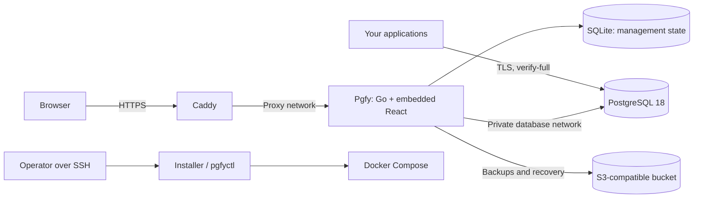

# Pgfy

**PostgreSQL for all your small projects, on one server you own — with backups you can actually restore.**

Pgfy turns a single Linux VPS into a managed home for the PostgreSQL databases behind your side projects, SaaS
experiments and client apps. You get a dashboard to create databases, hand out safe connection strings, control who
can connect, and back everything up to S3-compatible storage — and when the server is gone, you get the databases back
on a new one from the bucket alone.

You keep the server, the data and the bill. Pgfy does the database operations work in between.

## Why Pgfy exists

If you build more than one thing, you end up with more than one database. Each project starts small, but each one
wants somewhere to live:

- **A managed database per project adds up.** Paying a hosted provider separately for every small app, demo and
  client project gets expensive long before any of them has real traffic.
- **A shared VPS is cheap but becomes a second job.** Putting every database on one server spreads the cost, but now
  you are the DBA: creating roles by hand, editing `pg_hba.conf`, wiring up TLS, writing backup cron jobs, patching
  the host, and hoping nothing breaks.
- **Most self-hosted backups are never tested.** A `pg_dump` cron job that writes somewhere is not the same as being
  able to bring a database back on a fresh machine at 2 a.m. You usually find out which one you have when it is too
  late.

Pgfy exists to keep the cheap option without the second job. It is built for **students, indie developers and small
agencies** running several modest PostgreSQL workloads under one trusted administrator. It reduces the operational
work of self-hosting; it does not pretend to remove it.

## What it does

Pgfy is organised around three things you need from a database server.

### 1. Create a database in one step

Type a project name. Pgfy creates the database, a restricted role that can only reach that database, and a strong
generated password. Provisioning is resumable: an interrupted create picks up where it stopped and never produces a
silent duplicate.

### 2. Connect your application safely

- Copy-paste connection details with `sslmode=verify-full`, driver snippets, and an SSH-tunnel path for local work.
- Database TLS uses the same publicly trusted certificate as the dashboard, renewed and delivered automatically.
- Per-project allowed-address rules, applied and checked through PostgreSQL's own parser — or mark a database as open
  to the internet (TLS plus password) with a visible warning, for apps on platforms without a stable outbound address.
- A connection check you run from the application's own environment, so "connected" means something.
- Projects are isolated from each other; password rotation ends old sessions; per-database connection limits and a
  shared connection budget keep one app from starving the rest.

### 3. Recover when things go wrong

- Backups to any S3-compatible bucket you choose, on a schedule you set (every 1, 6, 12 or 24 hours, with a preferred hour for daily runs), plus
  "Back up now". Jobs survive browser closure and restarts, and a failing database backs off without blocking others.
- Retention keeps the newest backup of each database plus daily and weekly series, and only deletes when the bucket
  keeps versions of deleted objects.
- **Recovery from the bucket alone** on a freshly installed server: integrity and version checks, restore into a new
  project, and named verification checks reported honestly as *verified*, *partly verified* or *not verified*.
  New credentials are handed off for your application.
- A recovery kit (`pgfyctl export-recovery-kit`) and daily copies of management state for a damaged-but-surviving
  server.

### And the operational basics

- One-command install with HTTPS before any credentials are entered, a single administrator with a mandatory
  authenticator-app second factor, and an SSH-issued access reset.
- Alerts to a JSON webhook (Slack-compatible) for failing or late backups, PostgreSQL down, low disk, clock drift,
  certificate expiry and connection pressure — each at most daily, with a resolved message.
- Host status, unattended security updates, and `pgfyctl update` with an automatic rollback if anything fails.
- Freeze writes on a project before moving it; delete a database as a durable, confirmed job.
- An append-only audit record of administrative actions.

## What Pgfy is not

Being honest about limits is part of the product:

- **One server, not high availability.** Projects share CPU, memory, disk and the server's failure risk. Credentials
  separate projects logically; they do not give each one dedicated resources. Recovery restores to the latest backup;
  writes after it are not recovered, and there is no point-in-time recovery or automatic failover.
- **One administrator.** There are no teams, roles or customer accounts, and it is not a public multi-tenant database
  service.
- **It does not provision infrastructure.** You bring the VPS, DNS, firewall and bucket; Pgfy installs and runs the
  software on them. Nothing requires an AWS account, and compute and storage providers are independent choices.
- **Databases only.** Your applications run elsewhere and connect directly. There is no SQL editor and no connection
  pooler yet.

## Get started

You need an Ubuntu 24.04 LTS x86-64 VPS with root/sudo access and a DNS name pointing at it (or SSH-tunnel access
without a domain). Docker Engine 28+ and Compose 2.30+ are used when present, or installed at pinned versions.

```sh
(
  set -eu
  pgfy_bootstrap_dir=$(mktemp -d)
  trap 'rm -rf "$pgfy_bootstrap_dir"' EXIT
  curl --disable --fail --silent --show-error --location \
    --proto '=https' --proto-redir '=https' --connect-timeout 15 --max-time 120 \
    https://github.com/c-varun14/Pgfy/releases/latest/download/bootstrap.sh \
    -o "$pgfy_bootstrap_dir/bootstrap.sh"
  sudo bash "$pgfy_bootstrap_dir/bootstrap.sh" --hostname db-admin.example.com
)
```

The bootstrap verifies the release checksum before running anything, installs PostgreSQL 18, the dashboard and Caddy,
and prints the HTTPS address and setup token. Then open Settings, add your S3-compatible bucket, and create your first
project. The [installation guide](docs/installation.md) covers the full command, tunnel mode, downloaded bundles and
updates.

## Documentation

| Running Pgfy | Reference |
| --- | --- |
| [Installation and updates](docs/installation.md) | [API and security behaviour](docs/api.md) |
| [Recovery runbook](docs/recovery-runbook.md) | [Product design](docs/idea.md) |
| [Host runbook](docs/host-runbook.md) | [Release notes](docs/release-notes.md) |
| [Lightsail deployment](docs/lightsail.md) | [Roadmap and build history](docs/phases.md) |
| [Demo application](demo/README.md) | [Production checklist](docs/production-gate.md) |

## How it works



Three containers: Caddy for HTTPS, one Go application with the React dashboard embedded, and PostgreSQL. Management
state lives in SQLite so the dashboard keeps working — and can help you diagnose — when PostgreSQL is down. Backup and
restore jobs run in a durable in-process queue; there is no Redis, separate worker or Node server. The dashboard has no
Docker socket, no Caddy admin access, no bootstrap superuser credential and no cloud provider API access; host-level
operations go through `pgfyctl` over SSH.

## Status

Pgfy is at v0.4 and feature-complete for its single-administrator scope: create, connect, back up, recover, alert and
update are all implemented and covered by unit, browser and Compose integration tests. The
[production checklist](docs/production-gate.md) tracks the evidence that can only come from real servers and real
operation — certificate renewals, a full recovery rehearsal, measured resource use — and we recommend working through it
before moving important workloads. Next on the roadmap: weekly automated restore verification, signed release bundles
and more notification channels.

## Development

Use Go 1.27.1, Node 24.18.0, pnpm 10.17.1, Python 3, and Docker. Dependency versions and container image digests are
committed.

```sh
make install-deps
make test
make browser-test
make integration
```

Build frontend assets before compiling Go because the executable embeds `web/dist`. `make integration` builds the
application image, runs an isolated three-service fixture on `127.0.0.1:8080`, and removes only its generated test
containers and volumes. Do not run it simultaneously with the browser fixture, which uses the same port.

For a disposable dashboard preview:

```sh
make build
python3 scripts/e2e-server.py
```

Open `http://127.0.0.1:8080`; read the temporary setup token from `.cache/e2e-token` in a second terminal. PostgreSQL
intentionally reports unavailable in this browser fixture. Stopping it removes its SQLite database and key. Never bind
this development fixture to a public interface.

`PGFY_INTEGRATION_HOLD=300 python3 scripts/integration.py` keeps the integration stack running for five minutes after
the checks (credentials in `.cache/integration-hold.json`) so the full dashboard, including projects, backups and
recovery against a local S3-compatible store, can be explored at `http://127.0.0.1:8080`.

For frontend hot reload, start `python3 scripts/e2e-server.py --backend-only` and run `pnpm --dir web dev` in another
terminal. Vite serves loopback port 8080 and forwards API calls to the disposable backend on loopback port 3000,
preserving the configured authentication origin.

## Releases

Pull requests and pushes to `main` run verification. Version tags run verification before publishing an image to GHCR
and a checksummed bundle, plus `bootstrap.sh` and its checksum, to GitHub Releases. The release workflow tests the
release image and verifies an anonymous pull and public asset downloads. Fresh installations default to the latest
stable release; `--version` selects an explicit one, and reruns keep the installed version. Installers never resolve
newer tags or update an installation implicitly — updates go through `pgfyctl update`. Maintainers refresh image digests
explicitly with `python3 scripts/resolve-images.py`, then review and retest.
